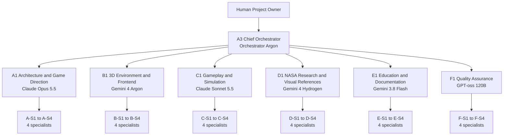

# Organization Chart

## Operating interpretation
The chart has 31 role identities: one orchestrator, six leads and 24 specialists. The bracketed specialist nodes are shorthand for the four individually named roles in the registry; every specialist has its own prompt file. Leads coordinate their four specialists directly. The Chief Orchestrator coordinates the leads. There is no recursive swarm hierarchy. In a platform without sub-agent launch support, each role runs in a separate human-opened session using its prompt and handoff packet.
